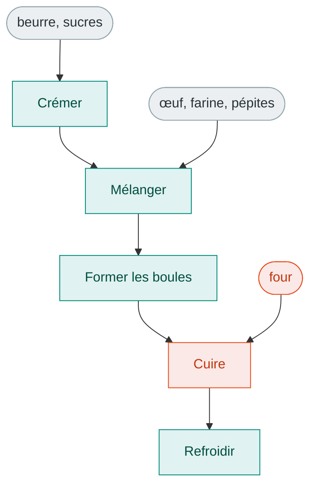

# Format des recettes

Cette spec est la référence : toute recette ajoutée ou modifiée la suit à la lettre. Le hook `hooks/recettes.py` affiche un avertissement au build quand une recette s'en écarte.

Principes : lisible d'un coup d'œil sur téléphone, le moins de mots possible, chaque information écrite à un seul endroit, rien d'inventé.

## Emplacement

- `docs/<categorie>/<slug>.md`, avec `<categorie>` = `plats` ou `desserts`
- slug : minuscules, sans accents, mots séparés par des tirets (`poulet-curry`)
- une recette = un fichier, sans photo

## Gabarit

````markdown
---
title: Nom de la recette
portions: 4
preparation: 20 min
cuisson: 35 min
tags: [volaille, rapide]
---

## Ingrédients

- [ ] **600 g** de blanc de poulet
- [ ] **2** oignons
- [ ] **2 c. à soupe** de curry en poudre
- [ ] **au goût** sel

### Pour la sauce

- [ ] **20 cl** de crème

## Schéma



## Instructions

1. **Couper** le poulet en dés.
2. **Faire revenir** 5 min à feu vif.
3. **Ajouter** la crème, **laisser mijoter** 20 min.

!!! tip "Astuce"
    Phrase courte.

## Notes

Phrase courte.
````

Le schéma du gabarit est un exemple de forme : le contenu vient de la recette. Les sections `Schéma` et `Notes` sont optionnelles, les autres obligatoires, dans cet ordre.

## Règles

### En-tête (front matter)

| Champ | Obligatoire | Format |
|---|---|---|
| `title` | oui | nom court de la recette |
| `portions` | oui | nombre entier |
| `preparation` | oui | `20 min`, `1 h`, `1 h 30 min` |
| `cuisson` | oui | idem, `0 min` s'il n'y a pas de cuisson |
| `tags` | non | liste en minuscules, sans accents |

Le titre de la page vient de `title` : pas de `# Titre` dans le corps. Le bandeau préparation / cuisson / portions est généré automatiquement sous le titre : ne jamais l'écrire dans le corps.

### Ingrédients

- une ligne par ingrédient, dans l'ordre d'utilisation : `- [ ] **quantité** nom`
- quantité en gras : nombre + unité métrique (`g`, `kg`, `ml`, `cl`, `l`, `c. à soupe`, `c. à café`, `pincée`), nombre seul pour ce qui se compte (`**2** œufs`), ou `**au goût**`
- après l'unité : « de » ou « d' » (`**600 g** de blanc de poulet`)
- sous-titres `###` seulement si la recette a des groupes (sauce, pâte…)

### Schéma (optionnel)

- ajouté si la recette a au moins 5 étapes ou des étapes en parallèle, sinon omis
- mêmes étapes que les instructions, dans le même ordre
- cases d'action : un verbe, sans complément ; durée ou température seulement si elles figurent dans la source
- ingrédients : nom exact de la liste, sans quantité, regroupés par étape d'entrée ; chaque ingrédient de la liste apparaît exactement une fois
- chaleur (four, poêle…) : entrée de l'étape de cuisson
- couleurs : copier les trois lignes `classDef` du gabarit (`ing` neutre, `act` action, `heat` chaleur)

### Instructions

- liste numérotée, une action par étape
- chaque étape commence par le verbe d'action à l'infinitif, en gras
- phrases courtes, forme impersonnelle (pas de « tu » ni de « vous »)
- températures en °C, durées en min

### Encadrés et notes

- `!!! tip "Astuce"` ou `!!! warning "Attention"`, placés après la liste d'instructions, 3 au maximum
- `Notes` : variantes, conservation, en quelques phrases

## Règles pour Claude

1. Lire cette spec et `CLAUDE.md` avant toute modification d'une recette.
2. Extraire de la source (texte, notes, photo) : titre, catégorie, portions, temps, ingrédients, étapes.
3. Ne jamais inventer une quantité, un temps, une température, un ingrédient ou une étape. Si une information obligatoire manque : poser une seule question groupée avant d'écrire. Si une information optionnelle manque : l'omettre.
4. Normaliser : unités métriques, verbes à l'infinitif, ordre d'utilisation des ingrédients, texte en français.
5. Créer `docs/<categorie>/<slug>.md` à partir du gabarit, puis :
   - ajouter la page dans `nav` de `mkdocs.yml`, par ordre alphabétique dans sa catégorie
   - ajouter son lien dans `docs/index.md`, au même endroit
6. Si un schéma est ajouté : vérifier que chaque ingrédient de la liste y apparaît une fois, et que les étapes sont celles des instructions.
7. Lancer `mkdocs build` : aucun avertissement du hook ne doit concerner le fichier ajouté.
8. Suivre les conventions de commit et de branche de `CLAUDE.md`.

Les deux ajouts manuels de l'étape 5 disparaîtront si le menu et l'accueil deviennent automatiques.
