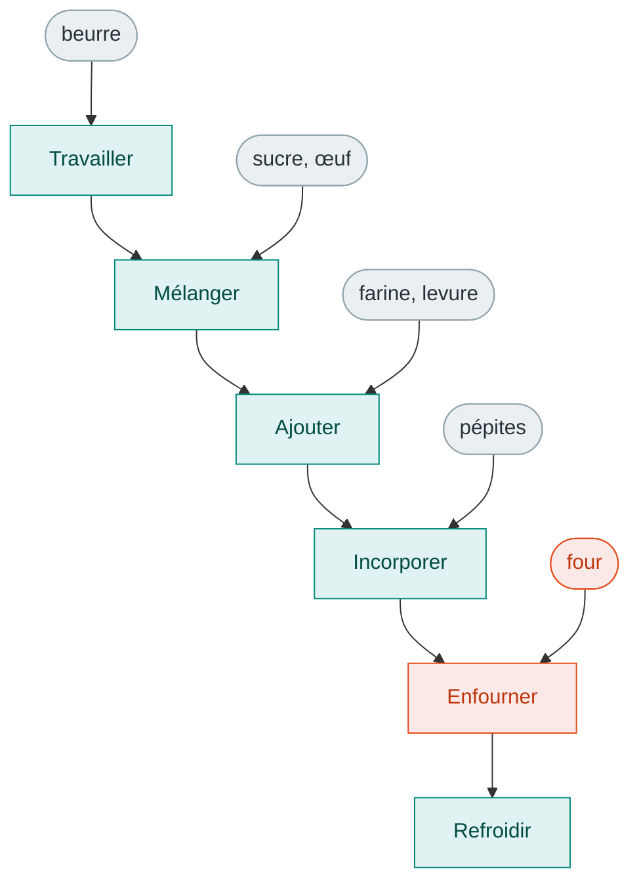

## Ingrédients

- [ ] **100 g** de beurre
- [ ] **100 g** de sucre
- [ ] **1** œuf
- [ ] **180 g** de farine
- [ ] **1 c. à café** de levure
- [ ] **120 g** de pépites de chocolat

## Schéma

## Instructions

1. **Travailler** le beurre en pommade.
2. **Mélanger** avec le sucre et l'œuf.
3. **Ajouter** la farine et la levure.
4. **Incorporer** les pépites de chocolat.
5. **Enfourner** à 180 °C, environ 9 min.
6. **Laisser refroidir** environ 2 min, puis décoller les cookies.

## Notes

Recette recopiée d'un post-it : cuisson et refroidissement à vérifier. Masse (pâte crue) et valeurs nutritionnelles estimées d'après Ciqual : œuf ≈ 50 g, levure ≈ 4 g et négligée dans les valeurs.
